```{r}
#| results: asis
#| fig-align: left
#| fig-height: 0.6
#| fig-width: 3

here::i_am("excel/excel_graphs_intro.qmd")
source(here::here("R/feed_block.R"))
feed_block(params$id)
source(here::here("R/next_sesh.R"), local = T)
next_sesh(rmarkdown::metadata$title)
```

## Acknowledgements
Sincere thanks to Matthew Hooks, Kristi Long, Steve Boulton, Anne Duffy, Roisin Farrell, Ellie Bates, Lynn Sproat, Catherine McLaren, Susanna Kirk, Brian Orpin, Albert Aspinall, Fatima Davila Acosta, Catherine Houston, Kevin Power, Gail Young, Elaine Adam, Sarah Downie, Katy McCalister, and other members of the KIND network for their contributions to this session.

## Session outline

This is a friendly overview and introduction to making graphs in Excel. You'll need basic Excel skills to complete this session, so we would usually recommend that you're confident with the content of our [beginner's Excel course](https://nes-dew.github.io/KIND-training/excel_main.html) before enrolling.

## What this session doesn't cover

- for basic Excel skills, see our [beginner's Excel course](https://nes-dew.github.io/KIND-training/excel_main.html)
- for Pivot Charts, see [our session on Pivot tables in our intermediate Excel course](https://nes-dew.github.io/KIND-training/excel/pivot_tables_and_pivot_charts.html)
- for background on the basics of drawing graphs, and why that's useful, please see our [introductory data skills course](https://nes-dew.github.io/KIND-training/skills/data_intro.html)

::: {.callout-note collapse="false" appearance="default" icon="true"}
## Data for this session

Later parts of this session use an extract from some real-world data about housing from [Open Data Scotland](https://opendata.scot/datasets/energy+saving+trust-energy+performance+certificates+%2528epc%2529+-+new+dwellings/). That describes energy performance certificates for new dwellings in Scotland until Q4 2025. [The full dataset](https://data.spatialhub.scot/dataset/8aa8ec4c-d343-4372-b29e-2d91f03097f4/resource/548c85d2-a6b1-41b5-9a8e-f454241eef4e/download/epc_historic_dataset_q4_2025_sap_new_dwellings.csv) is very large, so we're providing a short extract looking at dwellings in [Hawick](https://www.google.com/maps/place/Hawick/).

- [data](src/excel_graphs_intro_data.xlsx)
:::

## A first plot

In Excel, make sure you have the data open and editable, and then switch to the `first_plot` worksheet. That contains a tiny dataset summarising feedback for three teams:

```{r}
library(dplyr)

readxl::read_excel(here::here("excel/src/excel_graphs_intro_data.xlsx"), sheet = "first_plot") |>
  knitr::kable()
```

The very easiest way of inserting a new plot in Excel is to add a default plot. Let's do that now:

::: {.callout-note collapse="false" appearance="default" icon="true"}
## Task!

- Put your cursor inside the `first_plot` table of data
- Press `F11` (if you're working on a laptop keyboard, you might also need to hold down the `Fn` key)
:::

That *should* insert a new, default, plot for us in a new tab named `Chart1`:

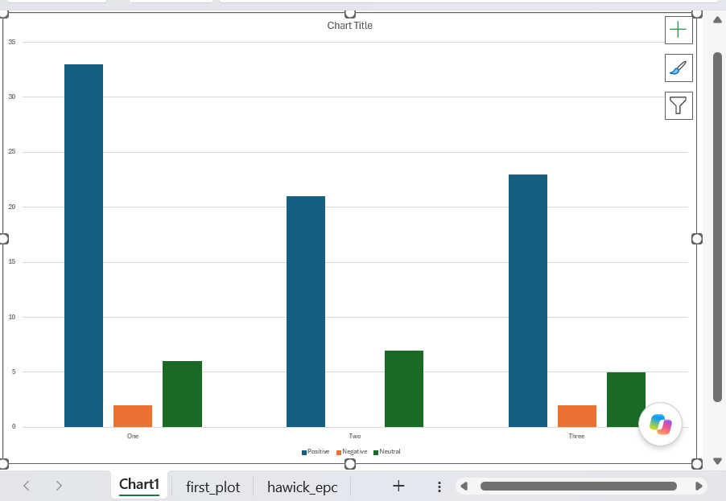

Congratulations! Update your CV, ask for a pay rise, you now know how to make a graph in Excel.

## Building our own plot

Alright, so there's clearly a bit more to making great graphs than pressing a single key. To help us understand what's what, let's try to build a simple plot now in a slightly more hands-on way.

::: {.callout-note collapse="false" appearance="default" icon="true"}
## Task!

- With your cursor inside the `first_plot` table of data, find the `Charts` section of the `Insert` menu in the ribbon
- From there, select the column chart option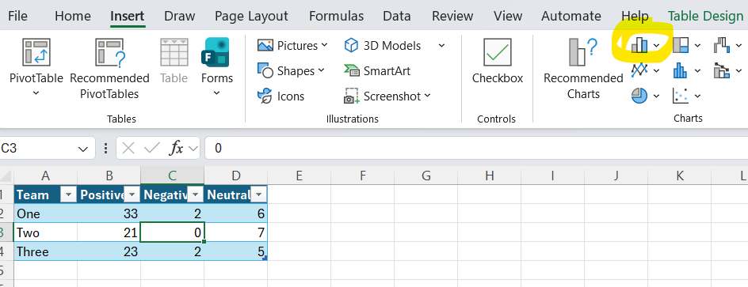
- That will open a sub-menu offering you several different column charts. Please pick the first `2D Column` option\
  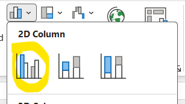
:::

That should generate a simple plot from your data:

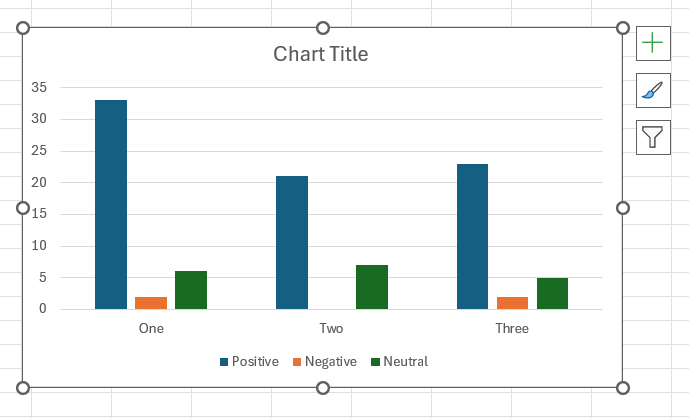

You should see that you've effectively re-created the default plot from the previous task. That's likely to look slightly different - inserted onto your worksheet, rather than occupying a whole tab of its own - but the structure of the graph should be exactly the same.

## The basics

When we asked Excel to make a graph for us, it looked at the way our data was held (in a table) and made some assumptions. Those assumptions are important for us to understand, and regrettably use some extremely odd (and partly Excel-specific) jargon:

- It plotted each of our value columns (Positive/Negative/Neutral) as a separate **series**, and the usual idea is that each series becomes a separate column in a graph
- Those series were then clustered into **categories** by the Team column, which are spread out horizontally along the X-axis
- The values (`33`, `21`, ...) in our data then determined the heights of the bars (indicated on the vertical Y-axis), showing us at a glance how many bits of feedback each team received in each category

If you look at your source data, you should see that Excel has applied some highlighting to show you how your data is being used:

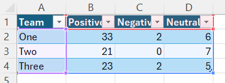

(purple outline here for the categories, red outline for the series labels, blue outline for the values)

Note that grouping happened automatically, and depends on some guessing on Excel's part. Luckily for us, we can change which bits of our data get used as a series:

::: {.callout-note collapse="false" appearance="default" icon="true"}
## Task!

- right-click your new chart, and select `Select Data...` 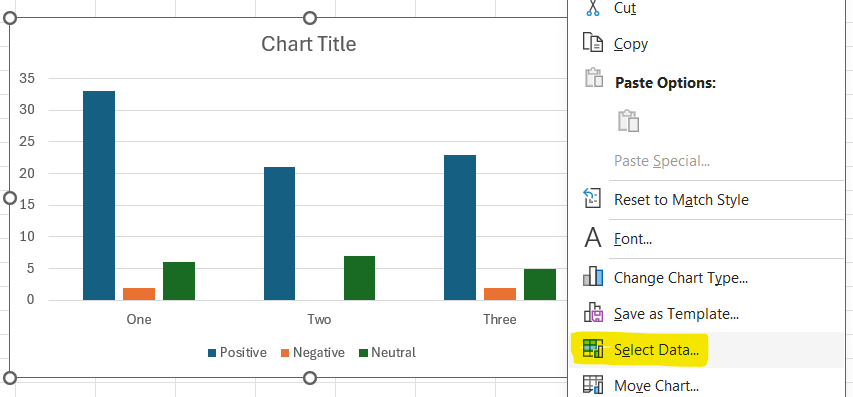

- That will bring up the `Select Data` interface. From it, select `Switch Row/Column` and click `OK`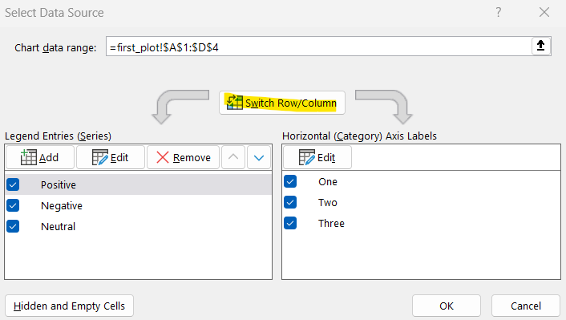

- Then see how your graph has changed
:::

I would expect your graph to now look like this:

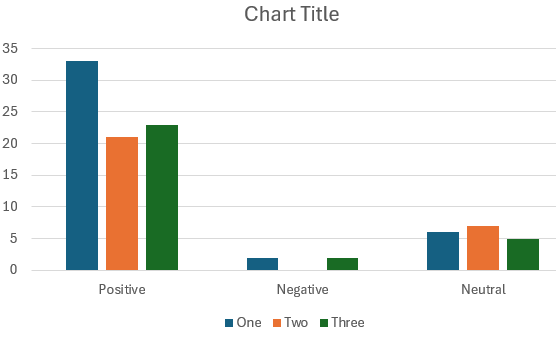

In Excel lingo, we've swapped the series and the categories, so our **series** are now the team names, and the **categories** are the types of feedback. You can get confirmation of that by inspecting your data, where the colours from the previous example will have swapped round:\

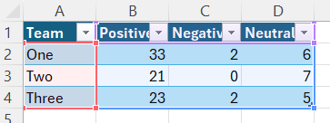

(purple outline here for the categories, red outline for the series labels, blue outline for the values)

We can do that because these groupings are a bit arbitrary for most kinds of data: there isn't a single right way to do them, and we can ask Excel to swap them round if they don't suit our purposes.

::: {.callout-note collapse="false" appearance="default" icon="true"}
## Task!

- Please swap your series/categories back again by following the steps in the task above again
:::

## Types of graph

Excel can make many different types of chart. Usefully, the process for making each type of chart (or changing between types of chart) is essentially the same.

::: {.callout-note collapse="false" appearance="default" icon="true"}
## Task!

- With your graph selected, find the column charts button in the `Charts` area of the `Insert` menu, and select the stacked column chart type

  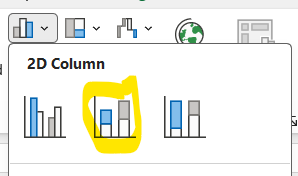

- Now inspect your graph: you should see that you've changed the way your data is presented. You've now got each category within a series stacked into a single bar. This is probably a poor way to compare your three teams, but a good way of seeing overall how the three series compare to one another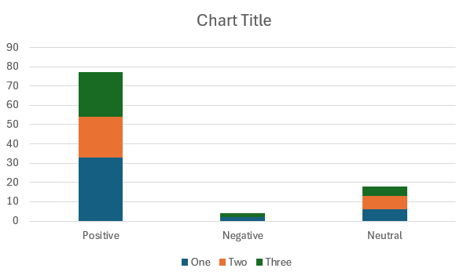

- In the same way, now change your graph to a 2D pie

  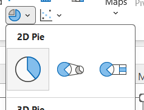.

  Note that will only show one series (Team one) at a time
:::

There's an alternative way of swapping between graph styles, which we'll explore once we've had a chance to think more about how our data feeds into our graph.

## Data for graphs

Excel graphs are opinionated about the data you can use in them. We've just seen a nice example of that, where we can only show a single category in a pie chart. Over the next few examples, we'll look at how to fit your data to suit different styles of chart.

::: {.callout-note collapse="false" appearance="default" icon="true"}
## Task!

- right-click your pie chart, and select `Select Data...` 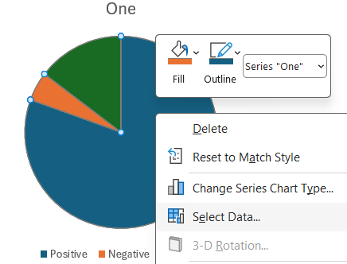

- Now `Remove` series One and Three, click `OK` and inspect your graph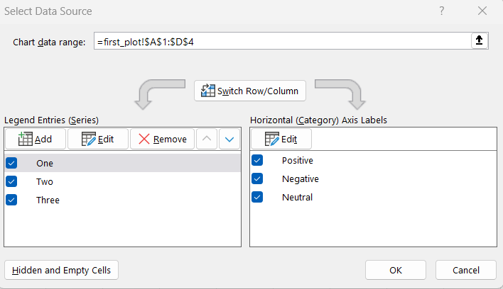

- Now `Switch Row/Column` and inspect your chart. You'll see that you'll have lost two of your categories, generating a less-than-ideal uniform pie-chart 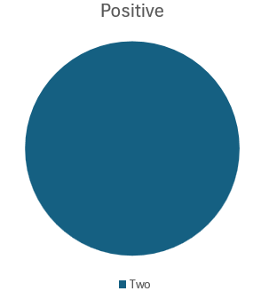

- To fix this, `Select Data...` again, and re-select the `Chart data range`

- That should generate a pie-chart with a useful breakdown of positive feedback by team

- 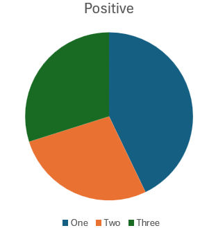
:::

## Finding a most-appropriate graph

As we mentioned above, there are constraints on what data each type of graph will show. Speaking personally, that's not very intuitive, so I often use a tool to preview many graphs for me to see what's going to happen to my data. Let's do that now:

::: {.callout-note collapse="false" appearance="default" icon="true"}
## Task!

- Switch over to the `epc` tab, which features a bit of real data about home energy performance certificates.

- Add that data to a new graph (of any kind), and then select `Change Chart Type...` from the right-click menu

  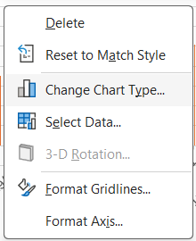

- That will bring up the `Change Chart Type` interface, which shows some useful previews of charts based on your data

  - Many of these will be bilge and nonsense

    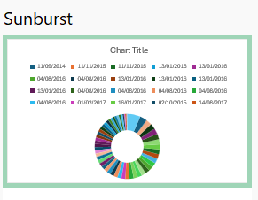

  - But you'll get many useful suggestions too

    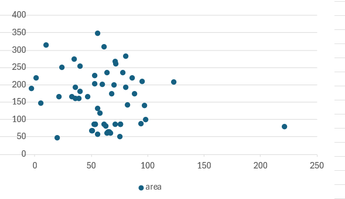{width="292"}

- Find a chart type that you like, and check that it's using the data that you want to show
:::

## Labelling

For me, that exercise generated a useful scatter graph of energy consumption against home area, but it didn't label the resulting chart very well at all:

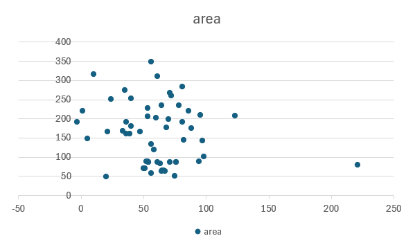

::: {.callout-note collapse="false" appearance="default" icon="true"}
## Task!

- From your chart, select the large `+` button on the right-hand margin, and make sure `Axis Titles` and `Chart Title` are selected

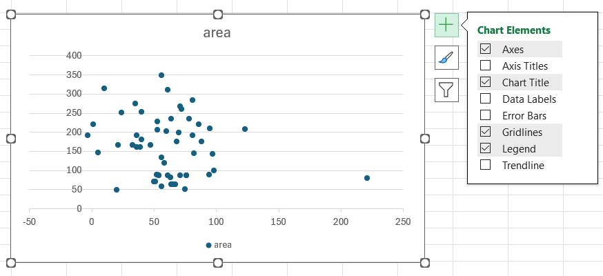

- You should then be able to edit the title and axis titles directly by double-clicking the text
- If you carefully click exactly on the bounding box (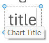) of the title you can also write a formula (or reference) to create a title dynamically, which might save you some typing
:::

## Dates

(tba - need to do some exploring in the pilot session)

## Styling

There are lots of options for styling graphs in Excel, which are most conveniently accessed from the right-hand menu too:

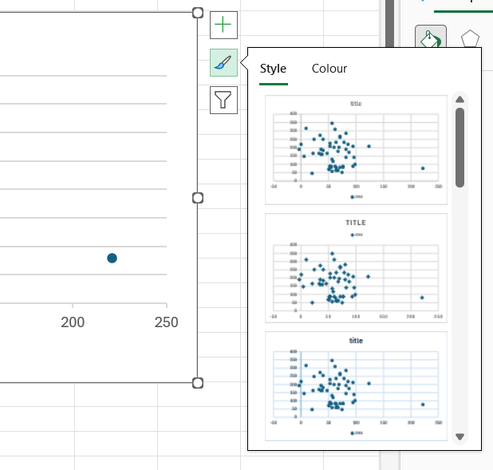

We'll explore some of the more useful formatting options during the session.

## Practice!

There's a much richer dataset in the `hawick_epc` tab which is provided for practice:

```{r}
readxl::read_excel(here::here("excel/src/excel_graphs_intro_data.xlsx"), sheet = "hawick_epc") |>
  mutate(across(contains("DATE"), \(x) lubridate::as_date(x))) |>
  select(1:5) |>
  slice(1:4) |>
  knitr::kable()
```
